# Construct DAG

> Generated by `scripts/build.py` from the `broader` field of each construct page and the `construct.measures` field of each metric page. Do not edit by hand. To change the structure, edit construct pages or `constructs/dag.yaml`, then run `python scripts/sync_constructs.py`.

Rounded boxes are constructs; square boxes are metrics. Solid arrows point from a broader construct to a narrower one; dotted arrows point from a construct to a metric that measures it.

```mermaid
graph TD
  c_ai_literacy(["Literacy: AI literacy"])
  c_annotation_quality(["Annotation quality"])
  c_classification_correctness(["Classification effectiveness: correctness"])
  c_classification_performance(["Classification performance"])
  c_component_characteristics(["Component characteristics"])
  c_component_performance(["Component performance"])
  c_information_literacy(["Literacy: information literacy"])
  c_interaction_friction(["Interaction friction"])
  c_interface_performance(["Interface performance"])
  c_label_completeness(["Annotation quality: completeness"])
  c_literacy(["Literacy"])
  c_machine_pre_annotation_quality(["Machine pre-annotation quality"])
  c_mental_workload(["Mental workload"])
  c_output_quality(["Output quality"])
  c_perceived_usability(["Usability: perceived usability"])
  c_relevance(["Retrieval effectiveness: relevance"])
  c_responsiveness(["System responsiveness"])
  c_retrieval_effectiveness(["Retrieval effectiveness"])
  c_retrieval_efficiency(["Retrieval efficiency"])
  c_retrieval_performance(["Retrieval performance"])
  c_system_characteristics(["System characteristics"])
  c_system_performance(["System performance"])
  c_system_reliability(["System reliability"])
  c_task_characteristics(["Task characteristics"])
  c_task_effectiveness(["Task effectiveness"])
  c_task_efficiency(["Task efficiency"])
  c_task_performance(["Task performance"])
  c_temporal_alignment(["Annotation tool: temporal alignment"])
  c_timeliness(["Retrieval effectiveness: timeliness"])
  c_topical_relevance(["Retrieval effectiveness: topical relevance"])
  c_trustworthiness(["Trustworthiness"])
  c_usability(["Usability"])
  c_user_characteristics(["User characteristics"])
  c_visualization_literacy(["Literacy: visualization literacy"])
  c_work_preservation(["Work preservation"])
  m_active_labeling_time_per_object["Active Labeling Time per Object"]:::metric
  m_frame_sync_accuracy["Frame-Sync Accuracy"]:::metric
  m_nasa_tlx["NASA Task Load Index (NASA-TLX)"]:::metric
  m_object_track_completeness["Object-Track Completeness"]:::metric
  m_pre_annotation_edit_rate["Pre-annotation Edit Rate"]:::metric
  m_precision["Precision"]:::metric
  m_recall["Recall"]:::metric
  m_response_latency["Response Latency"]:::metric
  m_system_usability_scale["System Usability Scale (SUS)"]:::metric
  m_task_completion_time["Task Completion Time"]:::metric
  m_work_loss_incidence["Work-Loss Incidence"]:::metric
  m_workaround_action_rate["Workaround Action Rate"]:::metric
  c_annotation_quality --> c_label_completeness
  c_classification_performance --> c_classification_correctness
  c_component_characteristics --> c_component_performance
  c_component_performance --> c_classification_performance
  c_component_performance --> c_interface_performance
  c_component_performance --> c_machine_pre_annotation_quality
  c_component_performance --> c_retrieval_performance
  c_interface_performance --> c_temporal_alignment
  c_literacy --> c_ai_literacy
  c_literacy --> c_information_literacy
  c_literacy --> c_visualization_literacy
  c_output_quality --> c_trustworthiness
  c_relevance --> c_timeliness
  c_relevance --> c_topical_relevance
  c_relevance --> c_trustworthiness
  c_retrieval_effectiveness --> c_relevance
  c_retrieval_performance --> c_retrieval_effectiveness
  c_retrieval_performance --> c_retrieval_efficiency
  c_system_characteristics --> c_system_performance
  c_system_performance --> c_output_quality
  c_system_performance --> c_system_reliability
  c_system_performance --> c_responsiveness
  c_system_reliability --> c_work_preservation
  c_task_characteristics --> c_task_performance
  c_task_characteristics --> c_usability
  c_task_effectiveness --> c_annotation_quality
  c_task_efficiency --> c_mental_workload
  c_task_performance --> c_task_effectiveness
  c_task_performance --> c_task_efficiency
  c_usability --> c_interaction_friction
  c_usability --> c_task_effectiveness
  c_usability --> c_task_efficiency
  c_usability --> c_perceived_usability
  c_user_characteristics --> c_literacy
  c_classification_correctness -.-> m_precision
  c_classification_correctness -.-> m_recall
  c_interaction_friction -.-> m_workaround_action_rate
  c_label_completeness -.-> m_object_track_completeness
  c_machine_pre_annotation_quality -.-> m_pre_annotation_edit_rate
  c_mental_workload -.-> m_nasa_tlx
  c_perceived_usability -.-> m_system_usability_scale
  c_responsiveness -.-> m_response_latency
  c_task_efficiency -.-> m_active_labeling_time_per_object
  c_task_efficiency -.-> m_task_completion_time
  c_temporal_alignment -.-> m_frame_sync_accuracy
  c_topical_relevance -.-> m_precision
  c_topical_relevance -.-> m_recall
  c_work_preservation -.-> m_work_loss_incidence
  classDef metric stroke-dasharray: 4 2
```

## As a nested list

A construct with several broader constructs appears under each of them.

- [Component characteristics](component-characteristics.md)
  - [Component performance](component-performance.md)
    - [Classification performance](classification-performance.md)
      - [Classification effectiveness: correctness](classification-correctness.md) · metrics: [Precision](../metrics/precision.md), [Recall](../metrics/recall.md)
    - [Interface performance](interface-performance.md)
      - [Annotation tool: temporal alignment](temporal-alignment.md) · metrics: [Frame-Sync Accuracy](../metrics/frame-sync-accuracy.md)
    - [Machine pre-annotation quality](machine-pre-annotation-quality.md) · metrics: [Pre-annotation Edit Rate](../metrics/pre-annotation-edit-rate.md)
    - [Retrieval performance](retrieval-performance.md)
      - [Retrieval effectiveness](retrieval-effectiveness.md)
        - [Retrieval effectiveness: relevance](relevance.md)
          - [Retrieval effectiveness: timeliness](timeliness.md)
          - [Retrieval effectiveness: topical relevance](topical-relevance.md) · metrics: [Precision](../metrics/precision.md), [Recall](../metrics/recall.md)
          - [Trustworthiness](trustworthiness.md)
      - [Retrieval efficiency](retrieval-efficiency.md)
- [System characteristics](system-characteristics.md)
  - [System performance](system-performance.md)
    - [Output quality](output-quality.md)
      - [Trustworthiness](trustworthiness.md)
    - [System reliability](system-reliability.md)
      - [Work preservation](work-preservation.md) · metrics: [Work-Loss Incidence](../metrics/work-loss-incidence.md)
    - [System responsiveness](responsiveness.md) · metrics: [Response Latency](../metrics/response-latency.md)
- [Task characteristics](task-characteristics.md)
  - [Task performance](task-performance.md)
    - [Task effectiveness](task-effectiveness.md)
      - [Annotation quality](annotation-quality.md)
        - [Annotation quality: completeness](label-completeness.md) · metrics: [Object-Track Completeness](../metrics/object-track-completeness.md)
    - [Task efficiency](task-efficiency.md) · metrics: [Active Labeling Time per Object](../metrics/active-labeling-time-per-object.md), [Task Completion Time](../metrics/task-completion-time.md)
      - [Mental workload](mental-workload.md) · metrics: [NASA Task Load Index (NASA-TLX)](../metrics/nasa-tlx.md)
  - [Usability](usability.md)
    - [Interaction friction](interaction-friction.md) · metrics: [Workaround Action Rate](../metrics/workaround-action-rate.md)
    - [Task effectiveness](task-effectiveness.md)
      - [Annotation quality](annotation-quality.md)
        - [Annotation quality: completeness](label-completeness.md) · metrics: [Object-Track Completeness](../metrics/object-track-completeness.md)
    - [Task efficiency](task-efficiency.md) · metrics: [Active Labeling Time per Object](../metrics/active-labeling-time-per-object.md), [Task Completion Time](../metrics/task-completion-time.md)
      - [Mental workload](mental-workload.md) · metrics: [NASA Task Load Index (NASA-TLX)](../metrics/nasa-tlx.md)
    - [Usability: perceived usability](perceived-usability.md) · metrics: [System Usability Scale (SUS)](../metrics/system-usability-scale.md)
- [User characteristics](user-characteristics.md)
  - [Literacy](literacy.md)
    - [Literacy: AI literacy](ai-literacy.md)
    - [Literacy: information literacy](information-literacy.md)
    - [Literacy: visualization literacy](visualization-literacy.md)

## Constructs with no metric yet

- [Annotation quality](annotation-quality.md)
- [Classification performance](classification-performance.md)
- [Component characteristics](component-characteristics.md)
- [Component performance](component-performance.md)
- [Interface performance](interface-performance.md)
- [Literacy](literacy.md)
- [Literacy: AI literacy](ai-literacy.md)
- [Literacy: information literacy](information-literacy.md)
- [Literacy: visualization literacy](visualization-literacy.md)
- [Output quality](output-quality.md)
- [Retrieval effectiveness](retrieval-effectiveness.md)
- [Retrieval effectiveness: relevance](relevance.md)
- [Retrieval effectiveness: timeliness](timeliness.md)
- [Retrieval efficiency](retrieval-efficiency.md)
- [Retrieval performance](retrieval-performance.md)
- [System characteristics](system-characteristics.md)
- [System performance](system-performance.md)
- [System reliability](system-reliability.md)
- [Task characteristics](task-characteristics.md)
- [Task effectiveness](task-effectiveness.md)
- [Task performance](task-performance.md)
- [Trustworthiness](trustworthiness.md)
- [Usability](usability.md)
- [User characteristics](user-characteristics.md)
