# Construct DAG

> Generated by `scripts/build.py` from the `broader` field of each construct page and the `construct.measures` field of each metric page. Do not edit by hand. To change the structure, edit construct pages or `constructs/dag.yaml`, then run `python scripts/sync_constructs.py`.

Rounded boxes are constructs; square boxes are metrics. Solid arrows point from a broader construct to a narrower one; dotted arrows point from a construct to a metric that measures it.

```mermaid
graph TD
  c_annotation_quality(["Annotation quality"])
  c_classification_correctness(["Classification effectiveness: correctness"])
  c_effectiveness(["Usability: effectiveness"])
  c_efficiency(["Usability: efficiency"])
  c_interaction_friction(["Interaction friction"])
  c_label_completeness(["Annotation quality: completeness"])
  c_mental_workload(["Mental workload"])
  c_output_quality(["Output quality"])
  c_perceived_usability(["Usability: perceived usability"])
  c_pre_annotation_quality(["Annotation quality: pre-annotation quality"])
  c_relevance(["Retrieval effectiveness: relevance"])
  c_responsiveness(["System responsiveness"])
  c_retrieval_effectiveness(["Retrieval effectiveness"])
  c_system_reliability(["System reliability"])
  c_temporal_alignment(["Annotation tool: temporal alignment"])
  c_timeliness(["Retrieval effectiveness: timeliness"])
  c_topical_relevance(["Retrieval effectiveness: topical relevance"])
  c_trustworthiness(["Trustworthiness"])
  c_usability(["Usability"])
  c_work_preservation(["Work preservation"])
  m_active_labeling_time_per_object["Active Labeling Time per Object"]:::metric
  m_frame_sync_accuracy["Frame-Sync Accuracy"]:::metric
  m_nasa_tlx["NASA Task Load Index (NASA-TLX)"]:::metric
  m_object_track_completeness["Object-Track Completeness"]:::metric
  m_pre_annotation_edit_rate["Pre-annotation Edit Rate"]:::metric
  m_precision["Precision"]:::metric
  m_recall["Recall"]:::metric
  m_response_latency["Response Latency"]:::metric
  m_system_usability_scale["System Usability Scale (SUS)"]:::metric
  m_task_completion_time["Task Completion Time"]:::metric
  m_work_loss_incidence["Work-Loss Incidence"]:::metric
  m_workaround_action_rate["Workaround Action Rate"]:::metric
  c_annotation_quality --> c_label_completeness
  c_annotation_quality --> c_pre_annotation_quality
  c_annotation_quality --> c_temporal_alignment
  c_effectiveness --> c_label_completeness
  c_efficiency --> c_mental_workload
  c_efficiency --> c_responsiveness
  c_output_quality --> c_annotation_quality
  c_output_quality --> c_classification_correctness
  c_output_quality --> c_trustworthiness
  c_relevance --> c_timeliness
  c_relevance --> c_topical_relevance
  c_relevance --> c_trustworthiness
  c_retrieval_effectiveness --> c_relevance
  c_system_reliability --> c_temporal_alignment
  c_system_reliability --> c_work_preservation
  c_usability --> c_interaction_friction
  c_usability --> c_effectiveness
  c_usability --> c_efficiency
  c_usability --> c_perceived_usability
  c_classification_correctness -.-> m_precision
  c_classification_correctness -.-> m_recall
  c_efficiency -.-> m_active_labeling_time_per_object
  c_efficiency -.-> m_task_completion_time
  c_interaction_friction -.-> m_workaround_action_rate
  c_label_completeness -.-> m_object_track_completeness
  c_mental_workload -.-> m_nasa_tlx
  c_perceived_usability -.-> m_system_usability_scale
  c_pre_annotation_quality -.-> m_pre_annotation_edit_rate
  c_responsiveness -.-> m_response_latency
  c_temporal_alignment -.-> m_frame_sync_accuracy
  c_topical_relevance -.-> m_precision
  c_topical_relevance -.-> m_recall
  c_work_preservation -.-> m_work_loss_incidence
  classDef metric stroke-dasharray: 4 2
```

## As a nested list

A construct with several broader constructs appears under each of them.

- [Output quality](output-quality.md)
  - [Annotation quality](annotation-quality.md)
    - [Annotation quality: completeness](label-completeness.md) · metrics: [Object-Track Completeness](../metrics/object-track-completeness.md)
    - [Annotation quality: pre-annotation quality](pre-annotation-quality.md) · metrics: [Pre-annotation Edit Rate](../metrics/pre-annotation-edit-rate.md)
    - [Annotation tool: temporal alignment](temporal-alignment.md) · metrics: [Frame-Sync Accuracy](../metrics/frame-sync-accuracy.md)
  - [Classification effectiveness: correctness](classification-correctness.md) · metrics: [Precision](../metrics/precision.md), [Recall](../metrics/recall.md)
  - [Trustworthiness](trustworthiness.md)
- [Retrieval effectiveness](retrieval-effectiveness.md)
  - [Retrieval effectiveness: relevance](relevance.md)
    - [Retrieval effectiveness: timeliness](timeliness.md)
    - [Retrieval effectiveness: topical relevance](topical-relevance.md) · metrics: [Precision](../metrics/precision.md), [Recall](../metrics/recall.md)
    - [Trustworthiness](trustworthiness.md)
- [System reliability](system-reliability.md)
  - [Annotation tool: temporal alignment](temporal-alignment.md) · metrics: [Frame-Sync Accuracy](../metrics/frame-sync-accuracy.md)
  - [Work preservation](work-preservation.md) · metrics: [Work-Loss Incidence](../metrics/work-loss-incidence.md)
- [Usability](usability.md)
  - [Interaction friction](interaction-friction.md) · metrics: [Workaround Action Rate](../metrics/workaround-action-rate.md)
  - [Usability: effectiveness](effectiveness.md)
    - [Annotation quality: completeness](label-completeness.md) · metrics: [Object-Track Completeness](../metrics/object-track-completeness.md)
  - [Usability: efficiency](efficiency.md) · metrics: [Active Labeling Time per Object](../metrics/active-labeling-time-per-object.md), [Task Completion Time](../metrics/task-completion-time.md)
    - [Mental workload](mental-workload.md) · metrics: [NASA Task Load Index (NASA-TLX)](../metrics/nasa-tlx.md)
    - [System responsiveness](responsiveness.md) · metrics: [Response Latency](../metrics/response-latency.md)
  - [Usability: perceived usability](perceived-usability.md) · metrics: [System Usability Scale (SUS)](../metrics/system-usability-scale.md)

## Constructs with no metric yet

- [Annotation quality](annotation-quality.md)
- [Output quality](output-quality.md)
- [Retrieval effectiveness](retrieval-effectiveness.md)
- [Retrieval effectiveness: relevance](relevance.md)
- [Retrieval effectiveness: timeliness](timeliness.md)
- [System reliability](system-reliability.md)
- [Trustworthiness](trustworthiness.md)
- [Usability](usability.md)
- [Usability: effectiveness](effectiveness.md)
