# Construct DAG

> Generated by `scripts/build.py` from the `broader` field of each construct page and the `construct.measures` field of each metric page. Do not edit by hand. To change the structure, edit construct pages or `constructs/dag.yaml`, then run `python scripts/sync_constructs.py`.

Rounded boxes are constructs; square boxes are metrics. Solid arrows point from a broader construct to a narrower one; dotted arrows point from a construct to a metric that measures it.

```mermaid
graph TD
  c_ai_literacy(["Literacy: AI literacy"])
  c_appropriate_reliance(["Reliance on AI: appropriateness"])
  c_autonomous_task_completion(["Autonomous task completion"])
  c_calibration(["Classification performance: calibration"])
  c_classification_correctness(["Classification effectiveness: correctness"])
  c_classification_performance(["Classification performance"])
  c_component_characteristics(["Component characteristics"])
  c_component_performance(["Component performance"])
  c_critical_visualization_literacy(["Literacy: critical visualization literacy"])
  c_decision_correctness(["Task effectiveness: decision correctness"])
  c_emotional_response(["User experience: emotional response"])
  c_explanation_faithfulness(["Explanation performance: faithfulness"])
  c_explanation_performance(["Explanation performance"])
  c_explanation_understanding(["Explanation understanding"])
  c_factuality(["Generation performance: factuality"])
  c_fairness(["Output quality: fairness"])
  c_generation_performance(["Generation performance"])
  c_groundedness(["Generation performance: groundedness"])
  c_information_literacy(["Literacy: information literacy"])
  c_literacy(["Literacy"])
  c_mental_workload(["Mental workload"])
  c_numeracy(["Literacy: numeracy"])
  c_output_quality(["Output quality"])
  c_perceived_usability(["Usability: perceived usability"])
  c_reference_similarity(["Generation performance: similarity to reference"])
  c_relevance(["Retrieval effectiveness: relevance"])
  c_reliance(["Reliance on AI"])
  c_resource_cost(["Resource cost"])
  c_responsiveness(["System responsiveness"])
  c_retrieval_effectiveness(["Retrieval effectiveness"])
  c_retrieval_efficiency(["Retrieval efficiency"])
  c_retrieval_performance(["Retrieval performance"])
  c_robustness(["System robustness"])
  c_run_consistency(["Consistency across runs"])
  c_safety(["Output quality: safety"])
  c_situational_relevance(["Task effectiveness: situational relevance"])
  c_system_characteristics(["System characteristics"])
  c_system_performance(["System performance"])
  c_task_characteristics(["Task characteristics"])
  c_task_effectiveness(["Task effectiveness"])
  c_task_efficiency(["Task efficiency"])
  c_task_performance(["Task performance"])
  c_timeliness(["Retrieval effectiveness: timeliness"])
  c_tool_call_correctness(["Tool-use performance: call correctness"])
  c_tool_use_performance(["Tool-use performance"])
  c_topical_relevance(["Retrieval effectiveness: topical relevance"])
  c_trust_in_system(["Trust in the system"])
  c_trustworthiness(["Trustworthiness"])
  c_usability(["Usability"])
  c_user_characteristics(["User characteristics"])
  c_user_experience(["User experience"])
  c_visualization_aesthetics(["User experience: visualization aesthetics"])
  c_visualization_literacy(["Literacy: visualization literacy"])
  m_nasa_tlx["NASA Task Load Index (NASA-TLX)"]:::metric
  m_precision_test_collection["Precision (test collection)"]:::metric
  m_precision_user_task["Precision (user on task)"]:::metric
  m_recall_test_collection["Recall (test collection)"]:::metric
  m_response_latency["Response Latency"]:::metric
  m_system_usability_scale["System Usability Scale (SUS)"]:::metric
  m_task_completion_time["Task Completion Time"]:::metric
  c_classification_performance --> c_classification_correctness
  c_classification_performance --> c_calibration
  c_component_characteristics --> c_component_performance
  c_component_performance --> c_classification_performance
  c_component_performance --> c_explanation_performance
  c_component_performance --> c_generation_performance
  c_component_performance --> c_retrieval_performance
  c_component_performance --> c_tool_use_performance
  c_explanation_performance --> c_explanation_faithfulness
  c_generation_performance --> c_factuality
  c_generation_performance --> c_groundedness
  c_generation_performance --> c_reference_similarity
  c_literacy --> c_ai_literacy
  c_literacy --> c_information_literacy
  c_literacy --> c_numeracy
  c_literacy --> c_visualization_literacy
  c_output_quality --> c_fairness
  c_output_quality --> c_safety
  c_output_quality --> c_trustworthiness
  c_relevance --> c_timeliness
  c_relevance --> c_topical_relevance
  c_relevance --> c_trustworthiness
  c_reliance --> c_appropriate_reliance
  c_retrieval_effectiveness --> c_relevance
  c_retrieval_performance --> c_retrieval_effectiveness
  c_retrieval_performance --> c_retrieval_efficiency
  c_system_characteristics --> c_resource_cost
  c_system_characteristics --> c_system_performance
  c_system_performance --> c_autonomous_task_completion
  c_system_performance --> c_run_consistency
  c_system_performance --> c_output_quality
  c_system_performance --> c_responsiveness
  c_system_performance --> c_robustness
  c_task_characteristics --> c_explanation_understanding
  c_task_characteristics --> c_reliance
  c_task_characteristics --> c_task_performance
  c_task_characteristics --> c_trust_in_system
  c_task_characteristics --> c_usability
  c_task_characteristics --> c_user_experience
  c_task_effectiveness --> c_decision_correctness
  c_task_effectiveness --> c_situational_relevance
  c_task_efficiency --> c_mental_workload
  c_task_performance --> c_task_effectiveness
  c_task_performance --> c_task_efficiency
  c_tool_use_performance --> c_tool_call_correctness
  c_usability --> c_task_effectiveness
  c_usability --> c_task_efficiency
  c_usability --> c_perceived_usability
  c_user_characteristics --> c_literacy
  c_user_experience --> c_emotional_response
  c_user_experience --> c_visualization_aesthetics
  c_visualization_literacy --> c_critical_visualization_literacy
  c_classification_correctness -.-> m_precision_test_collection
  c_classification_correctness -.-> m_recall_test_collection
  c_mental_workload -.-> m_nasa_tlx
  c_perceived_usability -.-> m_system_usability_scale
  c_responsiveness -.-> m_response_latency
  c_situational_relevance -.-> m_precision_user_task
  c_task_efficiency -.-> m_task_completion_time
  c_topical_relevance -.-> m_precision_test_collection
  c_topical_relevance -.-> m_recall_test_collection
  classDef metric stroke-dasharray: 4 2
```

## As a nested list

A construct with several broader constructs appears under each of them.

- [Component characteristics](component-characteristics.md)
  - [Component performance](component-performance.md)
    - [Classification performance](classification-performance.md)
      - [Classification effectiveness: correctness](classification-correctness.md) · metrics: [Precision (test collection)](../metrics/precision-test-collection.md), [Recall (test collection)](../metrics/recall-test-collection.md)
      - [Classification performance: calibration](calibration.md)
    - [Explanation performance](explanation-performance.md)
      - [Explanation performance: faithfulness](explanation-faithfulness.md)
    - [Generation performance](generation-performance.md)
      - [Generation performance: factuality](factuality.md)
      - [Generation performance: groundedness](groundedness.md)
      - [Generation performance: similarity to reference](reference-similarity.md)
    - [Retrieval performance](retrieval-performance.md)
      - [Retrieval effectiveness](retrieval-effectiveness.md)
        - [Retrieval effectiveness: relevance](relevance.md)
          - [Retrieval effectiveness: timeliness](timeliness.md)
          - [Retrieval effectiveness: topical relevance](topical-relevance.md) · metrics: [Precision (test collection)](../metrics/precision-test-collection.md), [Recall (test collection)](../metrics/recall-test-collection.md)
          - [Trustworthiness](trustworthiness.md)
      - [Retrieval efficiency](retrieval-efficiency.md)
    - [Tool-use performance](tool-use-performance.md)
      - [Tool-use performance: call correctness](tool-call-correctness.md)
- [System characteristics](system-characteristics.md)
  - [Resource cost](resource-cost.md)
  - [System performance](system-performance.md)
    - [Autonomous task completion](autonomous-task-completion.md)
    - [Consistency across runs](run-consistency.md)
    - [Output quality](output-quality.md)
      - [Output quality: fairness](fairness.md)
      - [Output quality: safety](safety.md)
      - [Trustworthiness](trustworthiness.md)
    - [System responsiveness](responsiveness.md) · metrics: [Response Latency](../metrics/response-latency.md)
    - [System robustness](robustness.md)
- [Task characteristics](task-characteristics.md)
  - [Explanation understanding](explanation-understanding.md)
  - [Reliance on AI](reliance.md)
    - [Reliance on AI: appropriateness](appropriate-reliance.md)
  - [Task performance](task-performance.md)
    - [Task effectiveness](task-effectiveness.md)
      - [Task effectiveness: decision correctness](decision-correctness.md)
      - [Task effectiveness: situational relevance](situational-relevance.md) · metrics: [Precision (user on task)](../metrics/precision-user-task.md)
    - [Task efficiency](task-efficiency.md) · metrics: [Task Completion Time](../metrics/task-completion-time.md)
      - [Mental workload](mental-workload.md) · metrics: [NASA Task Load Index (NASA-TLX)](../metrics/nasa-tlx.md)
  - [Trust in the system](trust-in-system.md)
  - [Usability](usability.md)
    - [Task effectiveness](task-effectiveness.md)
      - [Task effectiveness: decision correctness](decision-correctness.md)
      - [Task effectiveness: situational relevance](situational-relevance.md) · metrics: [Precision (user on task)](../metrics/precision-user-task.md)
    - [Task efficiency](task-efficiency.md) · metrics: [Task Completion Time](../metrics/task-completion-time.md)
      - [Mental workload](mental-workload.md) · metrics: [NASA Task Load Index (NASA-TLX)](../metrics/nasa-tlx.md)
    - [Usability: perceived usability](perceived-usability.md) · metrics: [System Usability Scale (SUS)](../metrics/system-usability-scale.md)
  - [User experience](user-experience.md)
    - [User experience: emotional response](emotional-response.md)
    - [User experience: visualization aesthetics](visualization-aesthetics.md)
- [User characteristics](user-characteristics.md)
  - [Literacy](literacy.md)
    - [Literacy: AI literacy](ai-literacy.md)
    - [Literacy: information literacy](information-literacy.md)
    - [Literacy: numeracy](numeracy.md)
    - [Literacy: visualization literacy](visualization-literacy.md)
      - [Literacy: critical visualization literacy](critical-visualization-literacy.md)

## Constructs with no metric yet

- [Autonomous task completion](autonomous-task-completion.md)
- [Classification performance](classification-performance.md)
- [Classification performance: calibration](calibration.md)
- [Component characteristics](component-characteristics.md)
- [Component performance](component-performance.md)
- [Consistency across runs](run-consistency.md)
- [Explanation performance](explanation-performance.md)
- [Explanation performance: faithfulness](explanation-faithfulness.md)
- [Explanation understanding](explanation-understanding.md)
- [Generation performance](generation-performance.md)
- [Generation performance: factuality](factuality.md)
- [Generation performance: groundedness](groundedness.md)
- [Generation performance: similarity to reference](reference-similarity.md)
- [Literacy](literacy.md)
- [Literacy: AI literacy](ai-literacy.md)
- [Literacy: critical visualization literacy](critical-visualization-literacy.md)
- [Literacy: information literacy](information-literacy.md)
- [Literacy: numeracy](numeracy.md)
- [Literacy: visualization literacy](visualization-literacy.md)
- [Output quality](output-quality.md)
- [Output quality: fairness](fairness.md)
- [Output quality: safety](safety.md)
- [Reliance on AI](reliance.md)
- [Reliance on AI: appropriateness](appropriate-reliance.md)
- [Resource cost](resource-cost.md)
- [Retrieval effectiveness](retrieval-effectiveness.md)
- [Retrieval effectiveness: relevance](relevance.md)
- [Retrieval effectiveness: timeliness](timeliness.md)
- [Retrieval efficiency](retrieval-efficiency.md)
- [Retrieval performance](retrieval-performance.md)
- [System characteristics](system-characteristics.md)
- [System performance](system-performance.md)
- [System robustness](robustness.md)
- [Task characteristics](task-characteristics.md)
- [Task effectiveness](task-effectiveness.md)
- [Task effectiveness: decision correctness](decision-correctness.md)
- [Task performance](task-performance.md)
- [Tool-use performance](tool-use-performance.md)
- [Tool-use performance: call correctness](tool-call-correctness.md)
- [Trust in the system](trust-in-system.md)
- [Trustworthiness](trustworthiness.md)
- [Usability](usability.md)
- [User characteristics](user-characteristics.md)
- [User experience](user-experience.md)
- [User experience: emotional response](emotional-response.md)
- [User experience: visualization aesthetics](visualization-aesthetics.md)
