# Construct DAG

> Generated by `scripts/build.py` from the `broader` field of each construct page and the `construct.measures` field of each metric page. Do not edit by hand. To change the structure, edit construct pages or `constructs/dag.yaml`, then run `python scripts/sync_constructs.py`.

Rounded boxes are constructs; square boxes are metrics. Solid arrows point from a broader construct to a narrower one; dotted arrows point from a construct to a metric that measures it.

```mermaid
graph TD
  c_ai_literacy(["Literacy: AI literacy"])
  c_answer_correctness(["Closed-answer performance: answer correctness"])
  c_appropriate_reliance(["Reliance on AI: appropriateness"])
  c_autonomous_task_completion(["Autonomous task completion"])
  c_autonomous_task_efficiency(["Autonomous task efficiency"])
  c_calibration(["Classification performance: calibration"])
  c_classification_correctness(["Classification effectiveness: correctness"])
  c_classification_performance(["Classification performance"])
  c_closed_answer_performance(["Closed-answer performance"])
  c_component_characteristics(["Component characteristics"])
  c_component_performance(["Component performance"])
  c_content_adequacy(["Generation performance: content adequacy"])
  c_critical_visualization_literacy(["Literacy: critical visualization literacy"])
  c_decision_correctness(["Task effectiveness: decision correctness"])
  c_demographics(["Background: demographics"])
  c_educational_background(["Background: education"])
  c_emotional_response(["User experience: emotional response"])
  c_explanation_faithfulness(["Explanation performance: faithfulness"])
  c_explanation_performance(["Explanation performance"])
  c_explanation_understanding(["Explanation understanding"])
  c_factuality(["Generation performance: factuality"])
  c_fairness(["Output quality: fairness"])
  c_functional_correctness(["Generation performance: functional correctness"])
  c_generation_performance(["Generation performance"])
  c_groundedness(["Generation performance: groundedness"])
  c_grounding_accuracy(["Grounding performance: localization accuracy"])
  c_grounding_performance(["Grounding performance"])
  c_image_generation_performance(["Image generation performance"])
  c_information_literacy(["Literacy: information literacy"])
  c_instruction_following(["Generation performance: instruction following"])
  c_literacy(["Literacy"])
  c_mental_workload(["Mental workload"])
  c_numeracy(["Literacy: numeracy"])
  c_numeric_prediction_accuracy(["Numeric prediction performance: accuracy"])
  c_numeric_prediction_performance(["Numeric prediction performance"])
  c_output_quality(["Output quality"])
  c_perceived_usability(["Usability: perceived usability"])
  c_relevance(["Retrieval effectiveness: relevance"])
  c_reliance(["Reliance on AI"])
  c_resource_cost(["Resource cost"])
  c_responsiveness(["System responsiveness"])
  c_retrieval_effectiveness(["Retrieval effectiveness"])
  c_retrieval_efficiency(["Retrieval efficiency"])
  c_retrieval_performance(["Retrieval performance"])
  c_robustness(["System robustness"])
  c_run_consistency(["Consistency across runs"])
  c_safety(["Output quality: safety"])
  c_saliency_prediction_accuracy(["Visual attention prediction performance: accuracy"])
  c_situational_relevance(["Task effectiveness: situational relevance"])
  c_system_characteristics(["System characteristics"])
  c_system_performance(["System performance"])
  c_task_characteristics(["Task characteristics"])
  c_task_effectiveness(["Task effectiveness"])
  c_task_efficiency(["Task efficiency"])
  c_task_performance(["Task performance"])
  c_text_image_alignment(["Image generation performance: text-image alignment"])
  c_timeliness(["Retrieval effectiveness: timeliness"])
  c_tool_call_correctness(["Tool-use performance: call correctness"])
  c_tool_use_performance(["Tool-use performance"])
  c_topical_relevance(["Retrieval effectiveness: topical relevance"])
  c_transcription_accuracy(["Transcription performance: accuracy"])
  c_transcription_performance(["Transcription performance"])
  c_trust_in_system(["Trust in the system"])
  c_trustworthiness(["Trustworthiness"])
  c_usability(["Usability"])
  c_user_background(["User background"])
  c_user_characteristics(["User characteristics"])
  c_user_experience(["User experience"])
  c_visual_attention_prediction_performance(["Visual attention prediction performance"])
  c_visualization_aesthetics(["User experience: visualization aesthetics"])
  c_visualization_literacy(["Literacy: visualization literacy"])
  m_accuracy["Accuracy"]:::metric
  m_action_efficiency_vs_humans["Action Efficiency Relative to Humans"]:::metric
  m_answer_faithfulness["Answer Faithfulness"]:::metric
  m_aopc["Area Over the Perturbation Curve (AOPC)"]:::metric
  m_attack_success_rate["Attack Success Rate (ASR)"]:::metric
  m_clipscore["CLIPScore"]:::metric
  m_cost_per_task["Cost per Task"]:::metric
  m_decision_accuracy_with_ai["Decision Accuracy with AI Assistance"]:::metric
  m_demographic_parity_difference["Demographic Parity Difference (DPD)"]:::metric
  m_demographic_profile["Demographic Profile (questionnaire)"]:::metric
  m_educational_attainment["Educational Attainment (questionnaire)"]:::metric
  m_elo_rating["Elo Rating (pairwise comparison)"]:::metric
  m_emotional_response_score["Emotional Response Score (questionnaire)"]:::metric
  m_expected_calibration_error["Expected Calibration Error (ECE)"]:::metric
  m_f1_score["F1 Score"]:::metric
  m_factscore["Factual Precision in Atomicity Score (FActScore)"]:::metric
  m_forward_prediction_accuracy["Forward-Prediction Accuracy"]:::metric
  m_grounding_accuracy["Grounding Accuracy"]:::metric
  m_instruction_following_accuracy["Instruction-Following Accuracy"]:::metric
  m_judge_rating["Judge Rating (model judge)"]:::metric
  m_learned_reference_score["Learned Reference-Based Score"]:::metric
  m_mean_average_precision["Mean Average Precision (MAP)"]:::metric
  m_mental_workload_score["Mental Workload Score (questionnaire)"]:::metric
  m_ndcg["Normalized Discounted Cumulative Gain (nDCG)"]:::metric
  m_numeracy_score["Numeracy Score (ability test)"]:::metric
  m_over_reliance_rate["Over-reliance Rate"]:::metric
  m_pass_at_k["pass@k"]:::metric
  m_pass_hat_k["pass^k"]:::metric
  m_perceived_usability_score["Perceived Usability Score (questionnaire)"]:::metric
  m_performance_drop_rate["Performance Drop Rate (PDR)"]:::metric
  m_precision_benchmark["Precision (benchmark)"]:::metric
  m_precision_user_task["Precision (user on task)"]:::metric
  m_recall_benchmark["Recall (benchmark)"]:::metric
  m_reciprocal_rank["Mean Reciprocal Rank (MRR)"]:::metric
  m_response_latency["Response Latency"]:::metric
  m_roc_auc["Area Under the ROC Curve (ROC-AUC)"]:::metric
  m_root_mean_squared_error["Root Mean Squared Error (RMSE)"]:::metric
  m_rouge["Recall-Oriented Understudy for Gisting Evaluation (ROUGE)"]:::metric
  m_saliency_map_similarity["Saliency Map Similarity (SIM)"]:::metric
  m_task_completion_time["Task Completion Time"]:::metric
  m_task_success_rate_benchmark["Task Success Rate (agent benchmark)"]:::metric
  m_task_success_rate_user["Task Success Rate (user on task)"]:::metric
  m_tool_call_accuracy["Tool Call Accuracy"]:::metric
  m_toxicity_rate["Toxicity Rate"]:::metric
  m_trust_score["Trust Score (questionnaire)"]:::metric
  m_under_reliance_rate["Under-reliance Rate"]:::metric
  m_user_experience_score["User Experience Score (questionnaire)"]:::metric
  m_visualization_aesthetics_score["Visualization Aesthetics Score (questionnaire)"]:::metric
  m_visualization_literacy_score["Visualization Literacy Score (ability test)"]:::metric
  m_win_rate["Win Rate (pairwise comparison)"]:::metric
  m_word_error_rate["Word Error Rate (WER)"]:::metric
  c_classification_performance --> c_classification_correctness
  c_classification_performance --> c_calibration
  c_closed_answer_performance --> c_answer_correctness
  c_component_characteristics --> c_component_performance
  c_component_performance --> c_classification_performance
  c_component_performance --> c_closed_answer_performance
  c_component_performance --> c_explanation_performance
  c_component_performance --> c_generation_performance
  c_component_performance --> c_grounding_performance
  c_component_performance --> c_image_generation_performance
  c_component_performance --> c_numeric_prediction_performance
  c_component_performance --> c_retrieval_performance
  c_component_performance --> c_tool_use_performance
  c_component_performance --> c_transcription_performance
  c_component_performance --> c_visual_attention_prediction_performance
  c_explanation_performance --> c_explanation_faithfulness
  c_generation_performance --> c_content_adequacy
  c_generation_performance --> c_factuality
  c_generation_performance --> c_functional_correctness
  c_generation_performance --> c_groundedness
  c_generation_performance --> c_instruction_following
  c_grounding_performance --> c_grounding_accuracy
  c_image_generation_performance --> c_text_image_alignment
  c_literacy --> c_ai_literacy
  c_literacy --> c_information_literacy
  c_literacy --> c_numeracy
  c_literacy --> c_visualization_literacy
  c_numeric_prediction_performance --> c_numeric_prediction_accuracy
  c_output_quality --> c_fairness
  c_output_quality --> c_safety
  c_output_quality --> c_trustworthiness
  c_relevance --> c_timeliness
  c_relevance --> c_topical_relevance
  c_relevance --> c_trustworthiness
  c_reliance --> c_appropriate_reliance
  c_retrieval_effectiveness --> c_relevance
  c_retrieval_performance --> c_retrieval_effectiveness
  c_retrieval_performance --> c_retrieval_efficiency
  c_system_characteristics --> c_resource_cost
  c_system_characteristics --> c_system_performance
  c_system_performance --> c_autonomous_task_completion
  c_system_performance --> c_autonomous_task_efficiency
  c_system_performance --> c_run_consistency
  c_system_performance --> c_output_quality
  c_system_performance --> c_responsiveness
  c_system_performance --> c_robustness
  c_task_characteristics --> c_explanation_understanding
  c_task_characteristics --> c_reliance
  c_task_characteristics --> c_task_performance
  c_task_characteristics --> c_trust_in_system
  c_task_characteristics --> c_usability
  c_task_characteristics --> c_user_experience
  c_task_effectiveness --> c_decision_correctness
  c_task_effectiveness --> c_situational_relevance
  c_task_efficiency --> c_mental_workload
  c_task_performance --> c_task_effectiveness
  c_task_performance --> c_task_efficiency
  c_tool_use_performance --> c_tool_call_correctness
  c_transcription_performance --> c_transcription_accuracy
  c_usability --> c_task_effectiveness
  c_usability --> c_task_efficiency
  c_usability --> c_perceived_usability
  c_user_background --> c_demographics
  c_user_background --> c_educational_background
  c_user_characteristics --> c_literacy
  c_user_characteristics --> c_user_background
  c_user_experience --> c_emotional_response
  c_user_experience --> c_visualization_aesthetics
  c_visual_attention_prediction_performance --> c_saliency_prediction_accuracy
  c_visualization_literacy --> c_critical_visualization_literacy
  c_answer_correctness -.-> m_accuracy
  c_answer_correctness -.-> m_f1_score
  c_answer_correctness -.-> m_pass_at_k
  c_appropriate_reliance -.-> m_over_reliance_rate
  c_appropriate_reliance -.-> m_under_reliance_rate
  c_autonomous_task_completion -.-> m_task_success_rate_benchmark
  c_autonomous_task_efficiency -.-> m_action_efficiency_vs_humans
  c_calibration -.-> m_expected_calibration_error
  c_classification_correctness -.-> m_accuracy
  c_classification_correctness -.-> m_f1_score
  c_classification_correctness -.-> m_precision_benchmark
  c_classification_correctness -.-> m_recall_benchmark
  c_classification_correctness -.-> m_roc_auc
  c_content_adequacy -.-> m_learned_reference_score
  c_content_adequacy -.-> m_rouge
  c_critical_visualization_literacy -.-> m_visualization_literacy_score
  c_decision_correctness -.-> m_decision_accuracy_with_ai
  c_demographics -.-> m_demographic_profile
  c_educational_background -.-> m_educational_attainment
  c_emotional_response -.-> m_emotional_response_score
  c_explanation_faithfulness -.-> m_aopc
  c_explanation_understanding -.-> m_forward_prediction_accuracy
  c_factuality -.-> m_factscore
  c_fairness -.-> m_demographic_parity_difference
  c_functional_correctness -.-> m_pass_at_k
  c_groundedness -.-> m_answer_faithfulness
  c_grounding_accuracy -.-> m_grounding_accuracy
  c_instruction_following -.-> m_instruction_following_accuracy
  c_mental_workload -.-> m_mental_workload_score
  c_numeracy -.-> m_numeracy_score
  c_numeric_prediction_accuracy -.-> m_root_mean_squared_error
  c_output_quality -.-> m_elo_rating
  c_output_quality -.-> m_judge_rating
  c_output_quality -.-> m_win_rate
  c_perceived_usability -.-> m_perceived_usability_score
  c_relevance -.-> m_ndcg
  c_resource_cost -.-> m_cost_per_task
  c_responsiveness -.-> m_response_latency
  c_robustness -.-> m_performance_drop_rate
  c_run_consistency -.-> m_pass_hat_k
  c_safety -.-> m_attack_success_rate
  c_safety -.-> m_toxicity_rate
  c_saliency_prediction_accuracy -.-> m_saliency_map_similarity
  c_situational_relevance -.-> m_precision_user_task
  c_task_effectiveness -.-> m_task_success_rate_user
  c_task_efficiency -.-> m_task_completion_time
  c_text_image_alignment -.-> m_clipscore
  c_tool_call_correctness -.-> m_tool_call_accuracy
  c_topical_relevance -.-> m_f1_score
  c_topical_relevance -.-> m_mean_average_precision
  c_topical_relevance -.-> m_precision_benchmark
  c_topical_relevance -.-> m_recall_benchmark
  c_topical_relevance -.-> m_reciprocal_rank
  c_transcription_accuracy -.-> m_word_error_rate
  c_trust_in_system -.-> m_trust_score
  c_user_experience -.-> m_user_experience_score
  c_visualization_aesthetics -.-> m_visualization_aesthetics_score
  c_visualization_literacy -.-> m_visualization_literacy_score
  classDef metric stroke-dasharray: 4 2
```

## As a nested list

A construct with several broader constructs appears under each of them.

- [Component characteristics](component-characteristics.md)
  - [Component performance](component-performance.md)
    - [Classification performance](classification-performance.md)
      - [Classification effectiveness: correctness](classification-correctness.md) · metrics: [Accuracy](../metrics/accuracy.md), [Area Under the ROC Curve (ROC-AUC)](../metrics/roc-auc.md), [F1 Score](../metrics/f1-score.md), [Precision (benchmark)](../metrics/precision-benchmark.md), [Recall (benchmark)](../metrics/recall-benchmark.md)
      - [Classification performance: calibration](calibration.md) · metrics: [Expected Calibration Error (ECE)](../metrics/expected-calibration-error.md)
    - [Closed-answer performance](closed-answer-performance.md)
      - [Closed-answer performance: answer correctness](answer-correctness.md) · metrics: [Accuracy](../metrics/accuracy.md), [F1 Score](../metrics/f1-score.md), [pass@k](../metrics/pass-at-k.md)
    - [Explanation performance](explanation-performance.md)
      - [Explanation performance: faithfulness](explanation-faithfulness.md) · metrics: [Area Over the Perturbation Curve (AOPC)](../metrics/aopc.md)
    - [Generation performance](generation-performance.md)
      - [Generation performance: content adequacy](content-adequacy.md) · metrics: [Learned Reference-Based Score](../metrics/learned-reference-score.md), [Recall-Oriented Understudy for Gisting Evaluation (ROUGE)](../metrics/rouge.md)
      - [Generation performance: factuality](factuality.md) · metrics: [Factual Precision in Atomicity Score (FActScore)](../metrics/factscore.md)
      - [Generation performance: functional correctness](functional-correctness.md) · metrics: [pass@k](../metrics/pass-at-k.md)
      - [Generation performance: groundedness](groundedness.md) · metrics: [Answer Faithfulness](../metrics/answer-faithfulness.md)
      - [Generation performance: instruction following](instruction-following.md) · metrics: [Instruction-Following Accuracy](../metrics/instruction-following-accuracy.md)
    - [Grounding performance](grounding-performance.md)
      - [Grounding performance: localization accuracy](grounding-accuracy.md) · metrics: [Grounding Accuracy](../metrics/grounding-accuracy.md)
    - [Image generation performance](image-generation-performance.md)
      - [Image generation performance: text-image alignment](text-image-alignment.md) · metrics: [CLIPScore](../metrics/clipscore.md)
    - [Numeric prediction performance](numeric-prediction-performance.md)
      - [Numeric prediction performance: accuracy](numeric-prediction-accuracy.md) · metrics: [Root Mean Squared Error (RMSE)](../metrics/root-mean-squared-error.md)
    - [Retrieval performance](retrieval-performance.md)
      - [Retrieval effectiveness](retrieval-effectiveness.md)
        - [Retrieval effectiveness: relevance](relevance.md) · metrics: [Normalized Discounted Cumulative Gain (nDCG)](../metrics/ndcg.md)
          - [Retrieval effectiveness: timeliness](timeliness.md)
          - [Retrieval effectiveness: topical relevance](topical-relevance.md) · metrics: [F1 Score](../metrics/f1-score.md), [Mean Average Precision (MAP)](../metrics/mean-average-precision.md), [Mean Reciprocal Rank (MRR)](../metrics/reciprocal-rank.md), [Precision (benchmark)](../metrics/precision-benchmark.md), [Recall (benchmark)](../metrics/recall-benchmark.md)
          - [Trustworthiness](trustworthiness.md)
      - [Retrieval efficiency](retrieval-efficiency.md)
    - [Tool-use performance](tool-use-performance.md)
      - [Tool-use performance: call correctness](tool-call-correctness.md) · metrics: [Tool Call Accuracy](../metrics/tool-call-accuracy.md)
    - [Transcription performance](transcription-performance.md)
      - [Transcription performance: accuracy](transcription-accuracy.md) · metrics: [Word Error Rate (WER)](../metrics/word-error-rate.md)
    - [Visual attention prediction performance](visual-attention-prediction-performance.md)
      - [Visual attention prediction performance: accuracy](saliency-prediction-accuracy.md) · metrics: [Saliency Map Similarity (SIM)](../metrics/saliency-map-similarity.md)
- [System characteristics](system-characteristics.md)
  - [Resource cost](resource-cost.md) · metrics: [Cost per Task](../metrics/cost-per-task.md)
  - [System performance](system-performance.md)
    - [Autonomous task completion](autonomous-task-completion.md) · metrics: [Task Success Rate (agent benchmark)](../metrics/task-success-rate-benchmark.md)
    - [Autonomous task efficiency](autonomous-task-efficiency.md) · metrics: [Action Efficiency Relative to Humans](../metrics/action-efficiency-vs-humans.md)
    - [Consistency across runs](run-consistency.md) · metrics: [pass^k](../metrics/pass-hat-k.md)
    - [Output quality](output-quality.md) · metrics: [Elo Rating (pairwise comparison)](../metrics/elo-rating.md), [Judge Rating (model judge)](../metrics/judge-rating.md), [Win Rate (pairwise comparison)](../metrics/win-rate.md)
      - [Output quality: fairness](fairness.md) · metrics: [Demographic Parity Difference (DPD)](../metrics/demographic-parity-difference.md)
      - [Output quality: safety](safety.md) · metrics: [Attack Success Rate (ASR)](../metrics/attack-success-rate.md), [Toxicity Rate](../metrics/toxicity-rate.md)
      - [Trustworthiness](trustworthiness.md)
    - [System responsiveness](responsiveness.md) · metrics: [Response Latency](../metrics/response-latency.md)
    - [System robustness](robustness.md) · metrics: [Performance Drop Rate (PDR)](../metrics/performance-drop-rate.md)
- [Task characteristics](task-characteristics.md)
  - [Explanation understanding](explanation-understanding.md) · metrics: [Forward-Prediction Accuracy](../metrics/forward-prediction-accuracy.md)
  - [Reliance on AI](reliance.md)
    - [Reliance on AI: appropriateness](appropriate-reliance.md) · metrics: [Over-reliance Rate](../metrics/over-reliance-rate.md), [Under-reliance Rate](../metrics/under-reliance-rate.md)
  - [Task performance](task-performance.md)
    - [Task effectiveness](task-effectiveness.md) · metrics: [Task Success Rate (user on task)](../metrics/task-success-rate-user.md)
      - [Task effectiveness: decision correctness](decision-correctness.md) · metrics: [Decision Accuracy with AI Assistance](../metrics/decision-accuracy-with-ai.md)
      - [Task effectiveness: situational relevance](situational-relevance.md) · metrics: [Precision (user on task)](../metrics/precision-user-task.md)
    - [Task efficiency](task-efficiency.md) · metrics: [Task Completion Time](../metrics/task-completion-time.md)
      - [Mental workload](mental-workload.md) · metrics: [Mental Workload Score (questionnaire)](../metrics/mental-workload-score.md)
  - [Trust in the system](trust-in-system.md) · metrics: [Trust Score (questionnaire)](../metrics/trust-score.md)
  - [Usability](usability.md)
    - [Task effectiveness](task-effectiveness.md) · metrics: [Task Success Rate (user on task)](../metrics/task-success-rate-user.md)
      - [Task effectiveness: decision correctness](decision-correctness.md) · metrics: [Decision Accuracy with AI Assistance](../metrics/decision-accuracy-with-ai.md)
      - [Task effectiveness: situational relevance](situational-relevance.md) · metrics: [Precision (user on task)](../metrics/precision-user-task.md)
    - [Task efficiency](task-efficiency.md) · metrics: [Task Completion Time](../metrics/task-completion-time.md)
      - [Mental workload](mental-workload.md) · metrics: [Mental Workload Score (questionnaire)](../metrics/mental-workload-score.md)
    - [Usability: perceived usability](perceived-usability.md) · metrics: [Perceived Usability Score (questionnaire)](../metrics/perceived-usability-score.md)
  - [User experience](user-experience.md) · metrics: [User Experience Score (questionnaire)](../metrics/user-experience-score.md)
    - [User experience: emotional response](emotional-response.md) · metrics: [Emotional Response Score (questionnaire)](../metrics/emotional-response-score.md)
    - [User experience: visualization aesthetics](visualization-aesthetics.md) · metrics: [Visualization Aesthetics Score (questionnaire)](../metrics/visualization-aesthetics-score.md)
- [User characteristics](user-characteristics.md)
  - [Literacy](literacy.md)
    - [Literacy: AI literacy](ai-literacy.md)
    - [Literacy: information literacy](information-literacy.md)
    - [Literacy: numeracy](numeracy.md) · metrics: [Numeracy Score (ability test)](../metrics/numeracy-score.md)
    - [Literacy: visualization literacy](visualization-literacy.md) · metrics: [Visualization Literacy Score (ability test)](../metrics/visualization-literacy-score.md)
      - [Literacy: critical visualization literacy](critical-visualization-literacy.md) · metrics: [Visualization Literacy Score (ability test)](../metrics/visualization-literacy-score.md)
  - [User background](user-background.md)
    - [Background: demographics](demographics.md) · metrics: [Demographic Profile (questionnaire)](../metrics/demographic-profile.md)
    - [Background: education](educational-background.md) · metrics: [Educational Attainment (questionnaire)](../metrics/educational-attainment.md)

## Constructs with no metric yet

- [Classification performance](classification-performance.md)
- [Closed-answer performance](closed-answer-performance.md)
- [Component characteristics](component-characteristics.md)
- [Component performance](component-performance.md)
- [Explanation performance](explanation-performance.md)
- [Generation performance](generation-performance.md)
- [Grounding performance](grounding-performance.md)
- [Image generation performance](image-generation-performance.md)
- [Literacy](literacy.md)
- [Literacy: AI literacy](ai-literacy.md)
- [Literacy: information literacy](information-literacy.md)
- [Numeric prediction performance](numeric-prediction-performance.md)
- [Reliance on AI](reliance.md)
- [Retrieval effectiveness](retrieval-effectiveness.md)
- [Retrieval effectiveness: timeliness](timeliness.md)
- [Retrieval efficiency](retrieval-efficiency.md)
- [Retrieval performance](retrieval-performance.md)
- [System characteristics](system-characteristics.md)
- [System performance](system-performance.md)
- [Task characteristics](task-characteristics.md)
- [Task performance](task-performance.md)
- [Tool-use performance](tool-use-performance.md)
- [Transcription performance](transcription-performance.md)
- [Trustworthiness](trustworthiness.md)
- [Usability](usability.md)
- [User background](user-background.md)
- [User characteristics](user-characteristics.md)
- [Visual attention prediction performance](visual-attention-prediction-performance.md)
