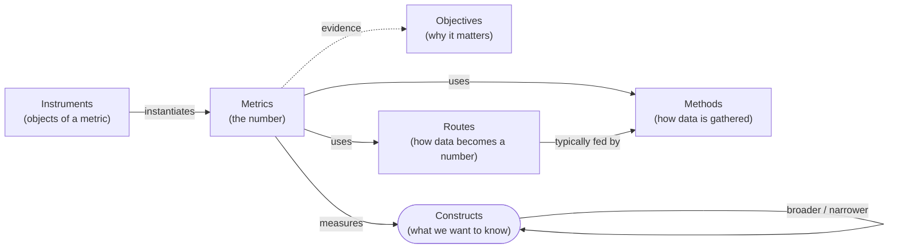

# Wiki map

> Generated by `scripts/build.py` from the front matter of every page. Do not edit by hand.

Every page in the wiki, linked from one place. The [README](../README.md) explains the design; [`schema/DECISIONS.md`](../schema/DECISIONS.md) gives the reasons for each decision.

## How the page types connect

Counts: 59 constructs, 39 metrics, 8 routes, 7 methods, 42 instrument entries.

## 1. Constructs and their metrics, by root

The construct DAG with the metrics attached to each construct. A construct with several broader constructs appears under each of them. The diagram version is in [constructs/index.md](../constructs/index.md).

### Component characteristics

- [Component characteristics](../constructs/component-characteristics.md)
  - [Component performance](../constructs/component-performance.md)
    - [Classification performance](../constructs/classification-performance.md)
      - [Classification effectiveness: correctness](../constructs/classification-correctness.md) — [Accuracy](../metrics/accuracy.md), [Area Under the ROC Curve (ROC-AUC)](../metrics/roc-auc.md), [F1 Score](../metrics/f1-score.md), [Precision (benchmark)](../metrics/precision-benchmark.md), [Recall (benchmark)](../metrics/recall-benchmark.md)
      - [Classification performance: calibration](../constructs/calibration.md) — [Expected Calibration Error (ECE)](../metrics/expected-calibration-error.md)
    - [Closed-answer performance](../constructs/closed-answer-performance.md)
      - [Closed-answer performance: answer correctness](../constructs/answer-correctness.md) — [Accuracy](../metrics/accuracy.md), [F1 Score](../metrics/f1-score.md), [pass@k](../metrics/pass-at-k.md)
    - [Explanation performance](../constructs/explanation-performance.md)
      - [Explanation performance: faithfulness](../constructs/explanation-faithfulness.md) — [Area Over the Perturbation Curve (AOPC)](../metrics/aopc.md)
    - [Generation performance](../constructs/generation-performance.md)
      - [Generation performance: content adequacy](../constructs/content-adequacy.md) — [Recall-Oriented Understudy for Gisting Evaluation (ROUGE)](../metrics/rouge.md)
      - [Generation performance: factuality](../constructs/factuality.md) — [Factual Precision in Atomicity Score (FActScore)](../metrics/factscore.md)
      - [Generation performance: functional correctness](../constructs/functional-correctness.md) — [pass@k](../metrics/pass-at-k.md)
      - [Generation performance: groundedness](../constructs/groundedness.md) — [Answer Faithfulness](../metrics/answer-faithfulness.md)
    - [Retrieval performance](../constructs/retrieval-performance.md)
      - [Retrieval effectiveness](../constructs/retrieval-effectiveness.md)
        - [Retrieval effectiveness: relevance](../constructs/relevance.md) — [Normalized Discounted Cumulative Gain (nDCG)](../metrics/ndcg.md)
          - [Retrieval effectiveness: timeliness](../constructs/timeliness.md)
          - [Retrieval effectiveness: topical relevance](../constructs/topical-relevance.md) — [F1 Score](../metrics/f1-score.md), [Mean Reciprocal Rank (MRR)](../metrics/reciprocal-rank.md), [Precision (benchmark)](../metrics/precision-benchmark.md), [Recall (benchmark)](../metrics/recall-benchmark.md)
          - [Trustworthiness](../constructs/trustworthiness.md)
      - [Retrieval efficiency](../constructs/retrieval-efficiency.md)
    - [Tool-use performance](../constructs/tool-use-performance.md)
      - [Tool-use performance: call correctness](../constructs/tool-call-correctness.md) — [Tool Call Accuracy](../metrics/tool-call-accuracy.md)

### System characteristics

- [System characteristics](../constructs/system-characteristics.md)
  - [Resource cost](../constructs/resource-cost.md) — [Cost per Task](../metrics/cost-per-task.md)
  - [System performance](../constructs/system-performance.md)
    - [Autonomous task completion](../constructs/autonomous-task-completion.md) — [Task Success Rate (agent benchmark)](../metrics/task-success-rate-benchmark.md)
    - [Consistency across runs](../constructs/run-consistency.md) — [pass^k](../metrics/pass-hat-k.md)
    - [Output quality](../constructs/output-quality.md)
      - [Output quality: fairness](../constructs/fairness.md) — [Demographic Parity Difference (DPD)](../metrics/demographic-parity-difference.md)
      - [Output quality: safety](../constructs/safety.md) — [Attack Success Rate (ASR)](../metrics/attack-success-rate.md), [Toxicity Rate](../metrics/toxicity-rate.md)
      - [Trustworthiness](../constructs/trustworthiness.md)
    - [System responsiveness](../constructs/responsiveness.md) — [Response Latency](../metrics/response-latency.md)
    - [System robustness](../constructs/robustness.md) — [Performance Drop Rate (PDR)](../metrics/performance-drop-rate.md)

### Task characteristics

- [Task characteristics](../constructs/task-characteristics.md)
  - [Explanation understanding](../constructs/explanation-understanding.md) — [Forward-Prediction Accuracy](../metrics/forward-prediction-accuracy.md)
  - [Reliance on AI](../constructs/reliance.md)
    - [Reliance on AI: appropriateness](../constructs/appropriate-reliance.md) — [Over-reliance Rate](../metrics/over-reliance-rate.md), [Under-reliance Rate](../metrics/under-reliance-rate.md)
  - [Task performance](../constructs/task-performance.md)
    - [Task effectiveness](../constructs/task-effectiveness.md) — [Task Success Rate (user on task)](../metrics/task-success-rate-user.md)
      - [Task effectiveness: decision correctness](../constructs/decision-correctness.md) — [Decision Accuracy with AI Assistance](../metrics/decision-accuracy-with-ai.md)
      - [Task effectiveness: situational relevance](../constructs/situational-relevance.md) — [Precision (user on task)](../metrics/precision-user-task.md)
    - [Task efficiency](../constructs/task-efficiency.md) — [Task Completion Time](../metrics/task-completion-time.md)
      - [Mental workload](../constructs/mental-workload.md) — [Mental Workload Score (questionnaire)](../metrics/mental-workload-score.md)
  - [Trust in the system](../constructs/trust-in-system.md) — [Trust Score (questionnaire)](../metrics/trust-score.md)
  - [Usability](../constructs/usability.md)
    - [Task effectiveness](../constructs/task-effectiveness.md) — [Task Success Rate (user on task)](../metrics/task-success-rate-user.md)
      - [Task effectiveness: decision correctness](../constructs/decision-correctness.md) — [Decision Accuracy with AI Assistance](../metrics/decision-accuracy-with-ai.md)
      - [Task effectiveness: situational relevance](../constructs/situational-relevance.md) — [Precision (user on task)](../metrics/precision-user-task.md)
    - [Task efficiency](../constructs/task-efficiency.md) — [Task Completion Time](../metrics/task-completion-time.md)
      - [Mental workload](../constructs/mental-workload.md) — [Mental Workload Score (questionnaire)](../metrics/mental-workload-score.md)
    - [Usability: perceived usability](../constructs/perceived-usability.md) — [Perceived Usability Score (questionnaire)](../metrics/perceived-usability-score.md)
  - [User experience](../constructs/user-experience.md) — [User Experience Score (questionnaire)](../metrics/user-experience-score.md)
    - [User experience: emotional response](../constructs/emotional-response.md) — [Emotional Response Score (questionnaire)](../metrics/emotional-response-score.md)
    - [User experience: visualization aesthetics](../constructs/visualization-aesthetics.md) — [Visualization Aesthetics Score (questionnaire)](../metrics/visualization-aesthetics-score.md)

### User characteristics

- [User characteristics](../constructs/user-characteristics.md)
  - [Literacy](../constructs/literacy.md)
    - [Literacy: AI literacy](../constructs/ai-literacy.md)
    - [Literacy: information literacy](../constructs/information-literacy.md)
    - [Literacy: numeracy](../constructs/numeracy.md) — [Numeracy Score (ability test)](../metrics/numeracy-score.md)
    - [Literacy: visualization literacy](../constructs/visualization-literacy.md) — [Visualization Literacy Score (ability test)](../metrics/visualization-literacy-score.md)
      - [Literacy: critical visualization literacy](../constructs/critical-visualization-literacy.md) — [Visualization Literacy Score (ability test)](../metrics/visualization-literacy-score.md)
  - [User background](../constructs/user-background.md)
    - [Background: demographics](../constructs/demographics.md) — [Demographic Profile (questionnaire)](../metrics/demographic-profile.md)
    - [Background: education](../constructs/educational-background.md) — [Educational Attainment (questionnaire)](../metrics/educational-attainment.md)

## 2. Metrics, by root

Each metric measures constructs under exactly one root (D20).

### Component characteristics

| Metric | Constructs | Methods | Routes |
|---|---|---|---|
| [Accuracy](../metrics/accuracy.md) | [Classification effectiveness: correctness](../constructs/classification-correctness.md), [Closed-answer performance: answer correctness](../constructs/answer-correctness.md) | [Benchmarks](../strategies/benchmark.md) | [Comparison against reference data](../strategies/reference-comparison.md) |
| [Answer Faithfulness](../metrics/answer-faithfulness.md) | [Generation performance: groundedness](../constructs/groundedness.md) | [Benchmarks](../strategies/benchmark.md) | [External judgment: annotators, experts, model judges, simulated users](../strategies/external-judgment.md) |
| [Area Over the Perturbation Curve (AOPC)](../metrics/aopc.md) | [Explanation performance: faithfulness](../constructs/explanation-faithfulness.md) | [Benchmarks](../strategies/benchmark.md), [Controlled comparison of conditions](../strategies/controlled-comparison.md) | [Difference scoring: changes between conditions](../strategies/difference-scoring.md) |
| [Area Under the ROC Curve (ROC-AUC)](../metrics/roc-auc.md) | [Classification effectiveness: correctness](../constructs/classification-correctness.md) | [Benchmarks](../strategies/benchmark.md) | [Comparison against reference data](../strategies/reference-comparison.md) |
| [Expected Calibration Error (ECE)](../metrics/expected-calibration-error.md) | [Classification performance: calibration](../constructs/calibration.md) | [Benchmarks](../strategies/benchmark.md) | [Comparison against reference data](../strategies/reference-comparison.md) |
| [F1 Score](../metrics/f1-score.md) | [Classification effectiveness: correctness](../constructs/classification-correctness.md), [Retrieval effectiveness: topical relevance](../constructs/topical-relevance.md), [Closed-answer performance: answer correctness](../constructs/answer-correctness.md) | [Benchmarks](../strategies/benchmark.md) | [Comparison against reference data](../strategies/reference-comparison.md) |
| [Factual Precision in Atomicity Score (FActScore)](../metrics/factscore.md) | [Generation performance: factuality](../constructs/factuality.md) | [Benchmarks](../strategies/benchmark.md) | [External judgment: annotators, experts, model judges, simulated users](../strategies/external-judgment.md), [Comparison against reference data](../strategies/reference-comparison.md) |
| [Mean Reciprocal Rank (MRR)](../metrics/reciprocal-rank.md) | [Retrieval effectiveness: topical relevance](../constructs/topical-relevance.md) | [Benchmarks](../strategies/benchmark.md) | [Comparison against reference data](../strategies/reference-comparison.md) |
| [Normalized Discounted Cumulative Gain (nDCG)](../metrics/ndcg.md) | [Retrieval effectiveness: relevance](../constructs/relevance.md) | [Benchmarks](../strategies/benchmark.md) | [Comparison against reference data](../strategies/reference-comparison.md), [External judgment: annotators, experts, model judges, simulated users](../strategies/external-judgment.md) |
| [pass@k](../metrics/pass-at-k.md) | [Generation performance: functional correctness](../constructs/functional-correctness.md), [Closed-answer performance: answer correctness](../constructs/answer-correctness.md) | [Benchmarks](../strategies/benchmark.md) | [Comparison against reference data](../strategies/reference-comparison.md) |
| [Precision (benchmark)](../metrics/precision-benchmark.md) | [Retrieval effectiveness: topical relevance](../constructs/topical-relevance.md), [Classification effectiveness: correctness](../constructs/classification-correctness.md) | [Benchmarks](../strategies/benchmark.md) | [Comparison against reference data](../strategies/reference-comparison.md), [External judgment: annotators, experts, model judges, simulated users](../strategies/external-judgment.md) |
| [Recall (benchmark)](../metrics/recall-benchmark.md) | [Retrieval effectiveness: topical relevance](../constructs/topical-relevance.md), [Classification effectiveness: correctness](../constructs/classification-correctness.md) | [Benchmarks](../strategies/benchmark.md) | [Comparison against reference data](../strategies/reference-comparison.md), [External judgment: annotators, experts, model judges, simulated users](../strategies/external-judgment.md) |
| [Recall-Oriented Understudy for Gisting Evaluation (ROUGE)](../metrics/rouge.md) | [Generation performance: content adequacy](../constructs/content-adequacy.md) | [Benchmarks](../strategies/benchmark.md) | [Comparison against reference data](../strategies/reference-comparison.md) |
| [Tool Call Accuracy](../metrics/tool-call-accuracy.md) | [Tool-use performance: call correctness](../constructs/tool-call-correctness.md) | [Benchmarks](../strategies/benchmark.md) | [Comparison against reference data](../strategies/reference-comparison.md) |

### System characteristics

| Metric | Constructs | Methods | Routes |
|---|---|---|---|
| [Attack Success Rate (ASR)](../metrics/attack-success-rate.md) | [Output quality: safety](../constructs/safety.md) | [Adversarial testing and red teaming](../strategies/adversarial-testing.md) | [External judgment: annotators, experts, model judges, simulated users](../strategies/external-judgment.md), [Comparison against reference data](../strategies/reference-comparison.md) |
| [Cost per Task](../metrics/cost-per-task.md) | [Resource cost](../constructs/resource-cost.md) | [Benchmarks](../strategies/benchmark.md), [Interaction logs and telemetry](../strategies/logs-telemetry.md) | [Direct reading: timing and counting](../strategies/direct-reading.md) |
| [Demographic Parity Difference (DPD)](../metrics/demographic-parity-difference.md) | [Output quality: fairness](../constructs/fairness.md) | [Controlled comparison of conditions](../strategies/controlled-comparison.md), [Benchmarks](../strategies/benchmark.md), [Interaction logs and telemetry](../strategies/logs-telemetry.md) | [Difference scoring: changes between conditions](../strategies/difference-scoring.md) |
| [pass^k](../metrics/pass-hat-k.md) | [Consistency across runs](../constructs/run-consistency.md) | [Benchmarks](../strategies/benchmark.md) | [Comparison against reference data](../strategies/reference-comparison.md) |
| [Performance Drop Rate (PDR)](../metrics/performance-drop-rate.md) | [System robustness](../constructs/robustness.md) | [Controlled comparison of conditions](../strategies/controlled-comparison.md), [Benchmarks](../strategies/benchmark.md) | [Difference scoring: changes between conditions](../strategies/difference-scoring.md) |
| [Response Latency](../metrics/response-latency.md) | [System responsiveness](../constructs/responsiveness.md) | [Interaction logs and telemetry](../strategies/logs-telemetry.md) | [Direct reading: timing and counting](../strategies/direct-reading.md) |
| [Task Success Rate (agent benchmark)](../metrics/task-success-rate-benchmark.md) | [Autonomous task completion](../constructs/autonomous-task-completion.md) | [Benchmarks](../strategies/benchmark.md) | [Comparison against reference data](../strategies/reference-comparison.md) |
| [Toxicity Rate](../metrics/toxicity-rate.md) | [Output quality: safety](../constructs/safety.md) | [Benchmarks](../strategies/benchmark.md), [Interaction logs and telemetry](../strategies/logs-telemetry.md) | [External judgment: annotators, experts, model judges, simulated users](../strategies/external-judgment.md) |

### Task characteristics

| Metric | Constructs | Methods | Routes |
|---|---|---|---|
| [Decision Accuracy with AI Assistance](../metrics/decision-accuracy-with-ai.md) | [Task effectiveness: decision correctness](../constructs/decision-correctness.md) | [Task studies with people](../strategies/task-study.md), [Controlled comparison of conditions](../strategies/controlled-comparison.md) | [Comparison against reference data](../strategies/reference-comparison.md) |
| [Emotional Response Score (questionnaire)](../metrics/emotional-response-score.md) | [User experience: emotional response](../constructs/emotional-response.md) | [Questionnaires and surveys](../strategies/questionnaire-survey.md) | [Self-rating: questionnaires and rating scales](../strategies/self-rating.md) |
| [Forward-Prediction Accuracy](../metrics/forward-prediction-accuracy.md) | [Explanation understanding](../constructs/explanation-understanding.md) | [Task studies with people](../strategies/task-study.md), [Controlled comparison of conditions](../strategies/controlled-comparison.md) | [Comparison against reference data](../strategies/reference-comparison.md) |
| [Mental Workload Score (questionnaire)](../metrics/mental-workload-score.md) | [Mental workload](../constructs/mental-workload.md) | [Questionnaires and surveys](../strategies/questionnaire-survey.md) | [Self-rating: questionnaires and rating scales](../strategies/self-rating.md) |
| [Over-reliance Rate](../metrics/over-reliance-rate.md) | [Reliance on AI: appropriateness](../constructs/appropriate-reliance.md) | [Task studies with people](../strategies/task-study.md) | [Comparison against reference data](../strategies/reference-comparison.md) |
| [Perceived Usability Score (questionnaire)](../metrics/perceived-usability-score.md) | [Usability: perceived usability](../constructs/perceived-usability.md) | [Questionnaires and surveys](../strategies/questionnaire-survey.md) | [Self-rating: questionnaires and rating scales](../strategies/self-rating.md) |
| [Precision (user on task)](../metrics/precision-user-task.md) | [Task effectiveness: situational relevance](../constructs/situational-relevance.md) | [Task studies with people](../strategies/task-study.md), [Interaction logs and telemetry](../strategies/logs-telemetry.md) | [Self-rating: questionnaires and rating scales](../strategies/self-rating.md), [Statistical and latent-variable modeling](../strategies/statistical-modeling.md) |
| [Task Completion Time](../metrics/task-completion-time.md) | [Task efficiency](../constructs/task-efficiency.md) | [Task studies with people](../strategies/task-study.md), [Interaction logs and telemetry](../strategies/logs-telemetry.md) | [Direct reading: timing and counting](../strategies/direct-reading.md) |
| [Task Success Rate (user on task)](../metrics/task-success-rate-user.md) | [Task effectiveness](../constructs/task-effectiveness.md) | [Task studies with people](../strategies/task-study.md), [Interaction logs and telemetry](../strategies/logs-telemetry.md) | [Comparison against reference data](../strategies/reference-comparison.md), [External judgment: annotators, experts, model judges, simulated users](../strategies/external-judgment.md) |
| [Trust Score (questionnaire)](../metrics/trust-score.md) | [Trust in the system](../constructs/trust-in-system.md) | [Questionnaires and surveys](../strategies/questionnaire-survey.md) | [Self-rating: questionnaires and rating scales](../strategies/self-rating.md) |
| [Under-reliance Rate](../metrics/under-reliance-rate.md) | [Reliance on AI: appropriateness](../constructs/appropriate-reliance.md) | [Task studies with people](../strategies/task-study.md) | [Comparison against reference data](../strategies/reference-comparison.md) |
| [User Experience Score (questionnaire)](../metrics/user-experience-score.md) | [User experience](../constructs/user-experience.md) | [Questionnaires and surveys](../strategies/questionnaire-survey.md) | [Self-rating: questionnaires and rating scales](../strategies/self-rating.md) |
| [Visualization Aesthetics Score (questionnaire)](../metrics/visualization-aesthetics-score.md) | [User experience: visualization aesthetics](../constructs/visualization-aesthetics.md) | [Questionnaires and surveys](../strategies/questionnaire-survey.md) | [Self-rating: questionnaires and rating scales](../strategies/self-rating.md) |

### User characteristics

| Metric | Constructs | Methods | Routes |
|---|---|---|---|
| [Demographic Profile (questionnaire)](../metrics/demographic-profile.md) | [Background: demographics](../constructs/demographics.md) | [Questionnaires and surveys](../strategies/questionnaire-survey.md) | [Direct reading: timing and counting](../strategies/direct-reading.md) |
| [Educational Attainment (questionnaire)](../metrics/educational-attainment.md) | [Background: education](../constructs/educational-background.md) | [Questionnaires and surveys](../strategies/questionnaire-survey.md) | [Direct reading: timing and counting](../strategies/direct-reading.md) |
| [Numeracy Score (ability test)](../metrics/numeracy-score.md) | [Literacy: numeracy](../constructs/numeracy.md) | [Ability tests](../strategies/ability-test.md) | [Comparison against reference data](../strategies/reference-comparison.md) |
| [Visualization Literacy Score (ability test)](../metrics/visualization-literacy-score.md) | [Literacy: visualization literacy](../constructs/visualization-literacy.md), [Literacy: critical visualization literacy](../constructs/critical-visualization-literacy.md) | [Ability tests](../strategies/ability-test.md) | [Comparison against reference data](../strategies/reference-comparison.md), [Statistical and latent-variable modeling](../strategies/statistical-modeling.md) |

## 3. Strategies

Two layers: methods gather the data; routes turn it into a number.

### Routes

| Route | Typical methods | Metrics |
|---|---|---|
| [Coding qualitative data](../strategies/qualitative-coding.md) | `interview`, `diary-esm`, `observation-think-aloud`, [Questionnaires and surveys](../strategies/questionnaire-survey.md) | — |
| [Comparative judgment: preferences and interleaving](../strategies/comparative-judgment.md) | [Task studies with people](../strategies/task-study.md), [Interaction logs and telemetry](../strategies/logs-telemetry.md), [Questionnaires and surveys](../strategies/questionnaire-survey.md) | — |
| [Comparison against reference data](../strategies/reference-comparison.md) | [Benchmarks](../strategies/benchmark.md), [Task studies with people](../strategies/task-study.md), [Ability tests](../strategies/ability-test.md), [Adversarial testing and red teaming](../strategies/adversarial-testing.md) | [Accuracy](../metrics/accuracy.md), [Area Under the ROC Curve (ROC-AUC)](../metrics/roc-auc.md), [Attack Success Rate (ASR)](../metrics/attack-success-rate.md), [Decision Accuracy with AI Assistance](../metrics/decision-accuracy-with-ai.md), [Expected Calibration Error (ECE)](../metrics/expected-calibration-error.md), [F1 Score](../metrics/f1-score.md), [Factual Precision in Atomicity Score (FActScore)](../metrics/factscore.md), [Forward-Prediction Accuracy](../metrics/forward-prediction-accuracy.md), [Mean Reciprocal Rank (MRR)](../metrics/reciprocal-rank.md), [Normalized Discounted Cumulative Gain (nDCG)](../metrics/ndcg.md), [Numeracy Score (ability test)](../metrics/numeracy-score.md), [Over-reliance Rate](../metrics/over-reliance-rate.md), [pass@k](../metrics/pass-at-k.md), [pass^k](../metrics/pass-hat-k.md), [Precision (benchmark)](../metrics/precision-benchmark.md), [Recall (benchmark)](../metrics/recall-benchmark.md), [Recall-Oriented Understudy for Gisting Evaluation (ROUGE)](../metrics/rouge.md), [Task Success Rate (agent benchmark)](../metrics/task-success-rate-benchmark.md), [Task Success Rate (user on task)](../metrics/task-success-rate-user.md), [Tool Call Accuracy](../metrics/tool-call-accuracy.md), [Under-reliance Rate](../metrics/under-reliance-rate.md), [Visualization Literacy Score (ability test)](../metrics/visualization-literacy-score.md) |
| [Difference scoring: changes between conditions](../strategies/difference-scoring.md) | [Controlled comparison of conditions](../strategies/controlled-comparison.md) | [Area Over the Perturbation Curve (AOPC)](../metrics/aopc.md), [Demographic Parity Difference (DPD)](../metrics/demographic-parity-difference.md), [Performance Drop Rate (PDR)](../metrics/performance-drop-rate.md) |
| [Direct reading: timing and counting](../strategies/direct-reading.md) | [Interaction logs and telemetry](../strategies/logs-telemetry.md), [Task studies with people](../strategies/task-study.md), [Benchmarks](../strategies/benchmark.md) | [Cost per Task](../metrics/cost-per-task.md), [Demographic Profile (questionnaire)](../metrics/demographic-profile.md), [Educational Attainment (questionnaire)](../metrics/educational-attainment.md), [Response Latency](../metrics/response-latency.md), [Task Completion Time](../metrics/task-completion-time.md) |
| [External judgment: annotators, experts, model judges, simulated users](../strategies/external-judgment.md) | [Benchmarks](../strategies/benchmark.md), `expert-inspection`, `simulation`, [Interaction logs and telemetry](../strategies/logs-telemetry.md), [Adversarial testing and red teaming](../strategies/adversarial-testing.md) | [Answer Faithfulness](../metrics/answer-faithfulness.md), [Attack Success Rate (ASR)](../metrics/attack-success-rate.md), [Factual Precision in Atomicity Score (FActScore)](../metrics/factscore.md), [Normalized Discounted Cumulative Gain (nDCG)](../metrics/ndcg.md), [Precision (benchmark)](../metrics/precision-benchmark.md), [Recall (benchmark)](../metrics/recall-benchmark.md), [Task Success Rate (user on task)](../metrics/task-success-rate-user.md), [Toxicity Rate](../metrics/toxicity-rate.md) |
| [Self-rating: questionnaires and rating scales](../strategies/self-rating.md) | [Questionnaires and surveys](../strategies/questionnaire-survey.md), `diary-esm`, [Task studies with people](../strategies/task-study.md) | [Emotional Response Score (questionnaire)](../metrics/emotional-response-score.md), [Mental Workload Score (questionnaire)](../metrics/mental-workload-score.md), [Perceived Usability Score (questionnaire)](../metrics/perceived-usability-score.md), [Precision (user on task)](../metrics/precision-user-task.md), [Trust Score (questionnaire)](../metrics/trust-score.md), [User Experience Score (questionnaire)](../metrics/user-experience-score.md), [Visualization Aesthetics Score (questionnaire)](../metrics/visualization-aesthetics-score.md) |
| [Statistical and latent-variable modeling](../strategies/statistical-modeling.md) | [Questionnaires and surveys](../strategies/questionnaire-survey.md), [Interaction logs and telemetry](../strategies/logs-telemetry.md) | [Precision (user on task)](../metrics/precision-user-task.md), [Visualization Literacy Score (ability test)](../metrics/visualization-literacy-score.md) |

### Methods

| Method | Routes that use it | Metrics |
|---|---|---|
| [Ability tests](../strategies/ability-test.md) | [Comparison against reference data](../strategies/reference-comparison.md) | [Numeracy Score (ability test)](../metrics/numeracy-score.md), [Visualization Literacy Score (ability test)](../metrics/visualization-literacy-score.md) |
| [Adversarial testing and red teaming](../strategies/adversarial-testing.md) | [Comparison against reference data](../strategies/reference-comparison.md), [External judgment: annotators, experts, model judges, simulated users](../strategies/external-judgment.md) | [Attack Success Rate (ASR)](../metrics/attack-success-rate.md) |
| [Benchmarks](../strategies/benchmark.md) | [Comparison against reference data](../strategies/reference-comparison.md), [Direct reading: timing and counting](../strategies/direct-reading.md), [External judgment: annotators, experts, model judges, simulated users](../strategies/external-judgment.md) | [Accuracy](../metrics/accuracy.md), [Answer Faithfulness](../metrics/answer-faithfulness.md), [Area Over the Perturbation Curve (AOPC)](../metrics/aopc.md), [Area Under the ROC Curve (ROC-AUC)](../metrics/roc-auc.md), [Cost per Task](../metrics/cost-per-task.md), [Demographic Parity Difference (DPD)](../metrics/demographic-parity-difference.md), [Expected Calibration Error (ECE)](../metrics/expected-calibration-error.md), [F1 Score](../metrics/f1-score.md), [Factual Precision in Atomicity Score (FActScore)](../metrics/factscore.md), [Mean Reciprocal Rank (MRR)](../metrics/reciprocal-rank.md), [Normalized Discounted Cumulative Gain (nDCG)](../metrics/ndcg.md), [pass@k](../metrics/pass-at-k.md), [pass^k](../metrics/pass-hat-k.md), [Performance Drop Rate (PDR)](../metrics/performance-drop-rate.md), [Precision (benchmark)](../metrics/precision-benchmark.md), [Recall (benchmark)](../metrics/recall-benchmark.md), [Recall-Oriented Understudy for Gisting Evaluation (ROUGE)](../metrics/rouge.md), [Task Success Rate (agent benchmark)](../metrics/task-success-rate-benchmark.md), [Tool Call Accuracy](../metrics/tool-call-accuracy.md), [Toxicity Rate](../metrics/toxicity-rate.md) |
| [Controlled comparison of conditions](../strategies/controlled-comparison.md) | [Difference scoring: changes between conditions](../strategies/difference-scoring.md) | [Area Over the Perturbation Curve (AOPC)](../metrics/aopc.md), [Decision Accuracy with AI Assistance](../metrics/decision-accuracy-with-ai.md), [Demographic Parity Difference (DPD)](../metrics/demographic-parity-difference.md), [Forward-Prediction Accuracy](../metrics/forward-prediction-accuracy.md), [Performance Drop Rate (PDR)](../metrics/performance-drop-rate.md) |
| [Interaction logs and telemetry](../strategies/logs-telemetry.md) | [Comparative judgment: preferences and interleaving](../strategies/comparative-judgment.md), [Direct reading: timing and counting](../strategies/direct-reading.md), [External judgment: annotators, experts, model judges, simulated users](../strategies/external-judgment.md), [Statistical and latent-variable modeling](../strategies/statistical-modeling.md) | [Cost per Task](../metrics/cost-per-task.md), [Demographic Parity Difference (DPD)](../metrics/demographic-parity-difference.md), [Precision (user on task)](../metrics/precision-user-task.md), [Response Latency](../metrics/response-latency.md), [Task Completion Time](../metrics/task-completion-time.md), [Task Success Rate (user on task)](../metrics/task-success-rate-user.md), [Toxicity Rate](../metrics/toxicity-rate.md) |
| [Questionnaires and surveys](../strategies/questionnaire-survey.md) | [Coding qualitative data](../strategies/qualitative-coding.md), [Comparative judgment: preferences and interleaving](../strategies/comparative-judgment.md), [Self-rating: questionnaires and rating scales](../strategies/self-rating.md), [Statistical and latent-variable modeling](../strategies/statistical-modeling.md) | [Demographic Profile (questionnaire)](../metrics/demographic-profile.md), [Educational Attainment (questionnaire)](../metrics/educational-attainment.md), [Emotional Response Score (questionnaire)](../metrics/emotional-response-score.md), [Mental Workload Score (questionnaire)](../metrics/mental-workload-score.md), [Perceived Usability Score (questionnaire)](../metrics/perceived-usability-score.md), [Trust Score (questionnaire)](../metrics/trust-score.md), [User Experience Score (questionnaire)](../metrics/user-experience-score.md), [Visualization Aesthetics Score (questionnaire)](../metrics/visualization-aesthetics-score.md) |
| [Task studies with people](../strategies/task-study.md) | [Comparative judgment: preferences and interleaving](../strategies/comparative-judgment.md), [Comparison against reference data](../strategies/reference-comparison.md), [Direct reading: timing and counting](../strategies/direct-reading.md), [Self-rating: questionnaires and rating scales](../strategies/self-rating.md) | [Decision Accuracy with AI Assistance](../metrics/decision-accuracy-with-ai.md), [Forward-Prediction Accuracy](../metrics/forward-prediction-accuracy.md), [Over-reliance Rate](../metrics/over-reliance-rate.md), [Precision (user on task)](../metrics/precision-user-task.md), [Task Completion Time](../metrics/task-completion-time.md), [Task Success Rate (user on task)](../metrics/task-success-rate-user.md), [Under-reliance Rate](../metrics/under-reliance-rate.md) |

Research methods without a page yet are listed in `research_method` in [`schema/vocabulary.yaml`](../schema/vocabulary.yaml).

## 4. Instruments

A metric page is a class; its instruments are objects (D25, D27): standardized questionnaires, tests and benchmarks. Lists are representative, not complete. Details are in section 2.6 of each metric page.

| Instrument | Metric | Probes | Scale |
|---|---|---|---|
| Adaptive CALVI (A-CALVI) | [Visualization Literacy Score (ability test)](../metrics/visualization-literacy-score.md) | not being misled by deceptive charts | latent ability (item response theory) |
| Adaptive VLAT (A-VLAT) | [Visualization Literacy Score (ability test)](../metrics/visualization-literacy-score.md) | reading well-made charts | latent ability (item response theory) |
| AdvBench | [Attack Success Rate (ASR)](../metrics/attack-success-rate.md) | refusal of harmful requests under jailbreak attacks | share of successful attacks, 0-1 |
| BeauVis Aesthetic Pleasure Scale | [Visualization Aesthetics Score (questionnaire)](../metrics/visualization-aesthetics-score.md) | — | 1-7 mean |
| BEIR | [Normalized Discounted Cumulative Gain (nDCG)](../metrics/ndcg.md) | retrieval across domains without in-domain training | nDCG@10, 0-1 |
| Berlin Numeracy Test | [Numeracy Score (ability test)](../metrics/numeracy-score.md) | statistical numeracy and risk literacy | number correct 0-4, or quartile 1-4 |
| CNN/DailyMail | [Recall-Oriented Understudy for Gisting Evaluation (ROUGE)](../metrics/rouge.md) | summarizing news articles in several sentences | ROUGE-1/2/L, 0-1 |
| Critical Thinking Assessment for Literacy in Visualizations (CALVI) | [Visualization Literacy Score (ability test)](../metrics/visualization-literacy-score.md) | not being misled by deceptive charts | share correct, 0-1, or latent ability |
| DecodingTrust | [Attack Success Rate (ASR)](../metrics/attack-success-rate.md) | trustworthiness under adversarial conditions, across several perspectives | per-perspective scores |
| FActScore biographies | [Factual Precision in Atomicity Score (FActScore)](../metrics/factscore.md) | factual precision of long-form text about people | share of supported facts, 0-1 |
| GAIA | [Task Success Rate (agent benchmark)](../metrics/task-success-rate-benchmark.md) | general assistant tasks needing browsing, tools and reasoning | share correct, 0-1 |
| Grade School Math 8K (GSM8K) | [Accuracy](../metrics/accuracy.md) | multi-step math reasoning | proportion, 0-1 |
| HarmBench | [Attack Success Rate (ASR)](../metrics/attack-success-rate.md) | refusal of harmful requests under automated red teaming | share of successful attacks, 0-1 |
| HellaSwag | [Accuracy](../metrics/accuracy.md) | commonsense reasoning about everyday situations | proportion, 0-1 |
| HumanEval | [pass@k](../metrics/pass-at-k.md) | writing short Python functions from a docstring | pass@k, 0-1 |
| Massive Multitask Language Understanding (MMLU) | [Accuracy](../metrics/accuracy.md) | knowledge across academic and professional subjects | proportion, 0-1 |
| Mini-VLAT | [Visualization Literacy Score (ability test)](../metrics/visualization-literacy-score.md) | reading well-made charts | share correct, 0-1 |
| Mostly Basic Python Problems (MBPP) | [pass@k](../metrics/pass-at-k.md) | writing entry-level Python programs from a description | pass@k, 0-1 |
| MS MARCO passage ranking | [Mean Reciprocal Rank (MRR)](../metrics/reciprocal-rank.md) | ranking a relevant passage for real search queries | MRR@10, 0-1 |
| NASA Task Load Index (NASA-TLX) | [Mental Workload Score (questionnaire)](../metrics/mental-workload-score.md) | — | 0-100 |
| PromptBench | [Performance Drop Rate (PDR)](../metrics/performance-drop-rate.md) | robustness to adversarial changes in prompts | relative drop, usually 0-1 |
| RealToxicityPrompts | [Toxicity Rate](../metrics/toxicity-rate.md) | toxic continuations of ordinary web text | share of toxic outputs, or expected maximum toxicity, 0-1 |
| Self-Assessment Manikin (SAM) | [Emotional Response Score (questionnaire)](../metrics/emotional-response-score.md) | pleasure, arousal and dominance | 1-9 per dimension (common form) |
| Stanford Question Answering Dataset (SQuAD) | [Accuracy](../metrics/accuracy.md) | reading comprehension | proportion, 0-1 (exact match) |
| Stanford Question Answering Dataset (SQuAD) | [F1 Score](../metrics/f1-score.md) | reading comprehension | token-overlap F1, 0-1 |
| Subjective Mental Effort Questionnaire (SMEQ) | [Mental Workload Score (questionnaire)](../metrics/mental-workload-score.md) | — | 0 to about 150 |
| SWE-bench | [Task Success Rate (agent benchmark)](../metrics/task-success-rate-benchmark.md) | resolving real software issues in a code repository | share resolved, 0-1 |
| System Usability Scale (SUS) | [Perceived Usability Score (questionnaire)](../metrics/perceived-usability-score.md) | — | 0-100 |
| tau-bench | [pass^k](../metrics/pass-hat-k.md) | tool use while talking with a simulated user under policies | pass^k, 0-1 |
| tau-bench | [Task Success Rate (agent benchmark)](../metrics/task-success-rate-benchmark.md) | tool use while talking with a simulated user under policies | share of successful episodes, 0-1 |
| TREC ad hoc collections | [Normalized Discounted Cumulative Gain (nDCG)](../metrics/ndcg.md) | topical relevance for ad hoc search | nDCG at a cutoff, 0-1 |
| TREC ad hoc collections | [Precision (benchmark)](../metrics/precision-benchmark.md) | topical relevance for ad hoc search | precision@k, 0-1 |
| TREC ad hoc collections | [Recall (benchmark)](../metrics/recall-benchmark.md) | topical relevance for ad hoc search | recall@k, 0-1 |
| TREC-8 Question Answering track | [Mean Reciprocal Rank (MRR)](../metrics/reciprocal-rank.md) | finding a correct answer to a factoid question | MRR, 0-1 |
| Trust in Automation Scale | [Trust Score (questionnaire)](../metrics/trust-score.md) | — | 1-7 mean |
| TruthfulQA (multiple-choice) | [Accuracy](../metrics/accuracy.md) | avoiding common misconceptions | proportion, 0-1 |
| UEQ-S | [User Experience Score (questionnaire)](../metrics/user-experience-score.md) | — | -3 to +3 per scale |
| UMUX-LITE | [Perceived Usability Score (questionnaire)](../metrics/perceived-usability-score.md) | — | 0-100 |
| Usability Metric for User Experience (UMUX) | [Perceived Usability Score (questionnaire)](../metrics/perceived-usability-score.md) | — | 0-100 |
| User Experience Questionnaire (UEQ) | [User Experience Score (questionnaire)](../metrics/user-experience-score.md) | — | -3 to +3 per scale |
| Visualization Literacy Assessment Test (VLAT) | [Visualization Literacy Score (ability test)](../metrics/visualization-literacy-score.md) | reading well-made charts | share correct, 0-1 |
| XSum | [Recall-Oriented Understudy for Gisting Evaluation (ROUGE)](../metrics/rouge.md) | summarizing news articles in one sentence | ROUGE-1/2/L, 0-1 |

## 5. Objectives

- [Improved usability](../objectives/improved-usability.md)
- [Sustained use](../objectives/sustained-use.md)

## 6. Schema

- [Page guide](../schema/page-guide.md): every section of every page type and the question it answers.
- Templates: [metric](../schema/metric-template.md), [construct](../schema/construct-template.md), [strategy](../schema/strategy-template.md).
- [Vocabulary](../schema/vocabulary.yaml): allowed tag values.
- [Decisions](../schema/DECISIONS.md): what was decided, why, and what was considered instead.
- [Bibliography](../references/bibliography.yaml): every source pages may cite.
